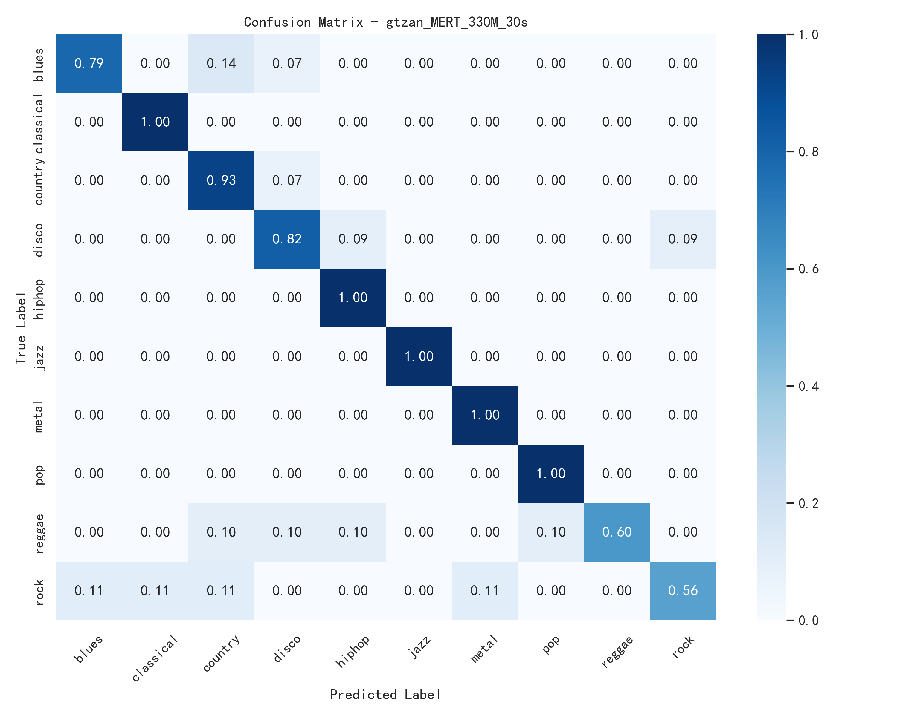
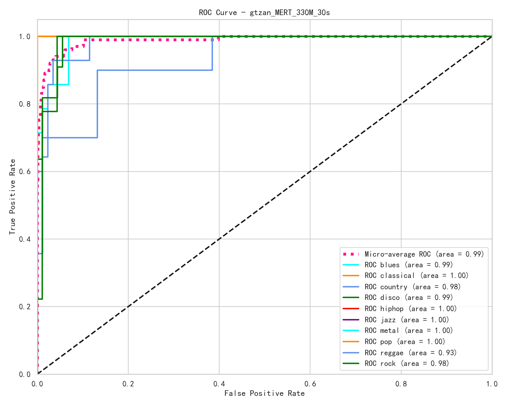
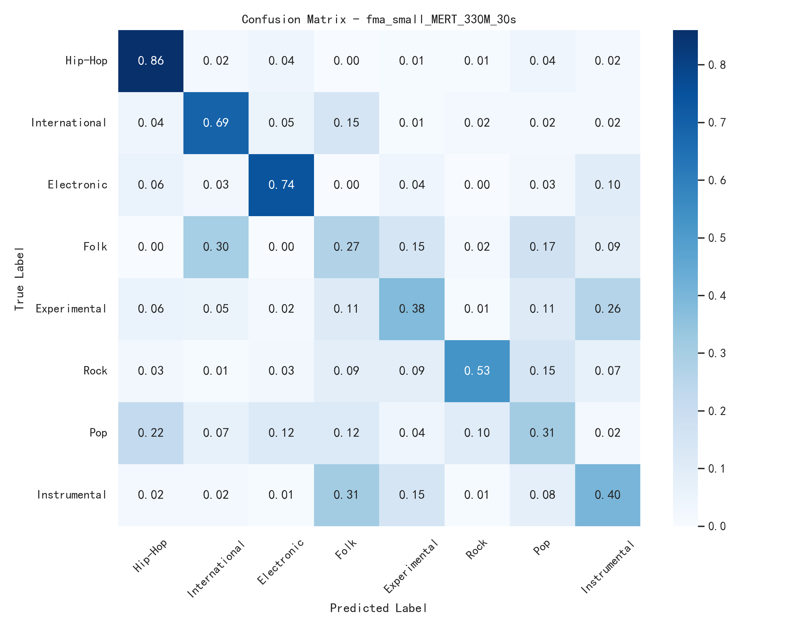
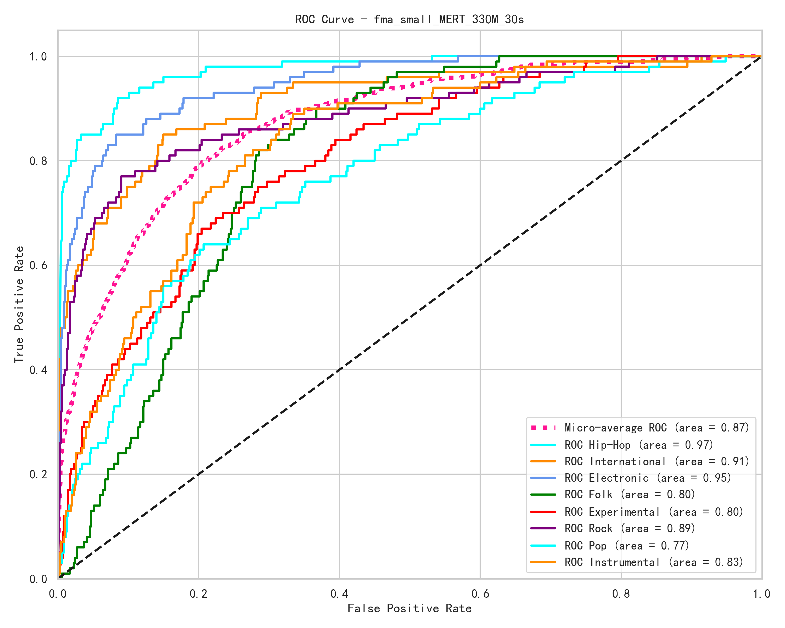

# Music Genre Classification with MERT 🎵


​	这是一个基于 **MERT (**Music und**ER**standing model with large-scale self-supervised **T**raining)预训练特征的音乐流派分类项目。项目利用 MERT 强大的音频理解能力提取特征，并结合 MLP 分类头，在 **GTZAN** 和 **FMA Small** 数据集上实现流派分类。

> 本人并无代码能力，故大多代码为Gemini所写或是从读过的论文中附带的开源项目中参考。

## 📂 项目结构 (Directory Structure)
```text
Music-Genre-Classification-MERT/
├── assets/                  # 存放 README 展示用的图片
├── configs/                 # 配置文件
│   ├── model/               # MERT 95M/330M 的特定配置
│   ├── config.yaml          # 全局训练配置
│   └── dataset.yaml         # 数据集路径配置
├── data/                    # 该实验使用的数据集
├── results/                 # 实验结果图表
│   ├── confusion_matrix/    # 混淆矩阵图
│   ├── roc_curvs/           # ROC 曲线图
│   └── mert_95mVS330m.png   # 对比mert两个参数模型的效果
├── src/                     # 源代码
│   ├── extract_feature.py   # 特征提取脚本
│   ├── train.py             # 训练脚本
│   ├── model.py             # 模型定义
│   └── ...
├── requirements.txt         # 项目依赖
└── README.md


```

## 📊 实验结果 (Results)

​	本项目在 **GTZAN** (10分类) 和 **FMA Small** (8分类) 数据集上进行实验。对比不同参数规模的预训练模型 (`MERT-95M` 和 `MERT-330M`) 对分类效果的影响。

### 1. MERT模型

​	MERT类似于自然语言中的BERT或语音领域的HuBERT，它专门为音乐设计，通过在大规模音乐数据上进行自监督学习，学会如何理解音乐的节奏，音高和流派等特征。

#### MERT-95M

​	轻量级，参数量95 Million，12层Transformer，特征维度768维。

#### MERT-330M

​	高性能，参数量330 Million，24层Transformer，特征维度1024维。

---

### 2. GTZAN 数据集
> **模型**: MERT-330M

​	如下两图分别为，在 GTZAN 数据集上，使用MERT-330M 作为特征提取器，后接分类头训练之后的混淆矩阵和ROC曲线图。

> gtzan数据集，一共十个流派，每个流派有一千首，时长为30s。但数据集里面有许多完全相同的歌曲被切为不同片段，对于训练会让模型记住这首歌，而非学会流派，同时里面会有错误的标注。

|                 混淆矩阵 (Confusion Matrix)                  |                  ROC 曲线 (ROC Curve)                   |
| :----------------------------------------------------------: | :-----------------------------------------------------: |
|  |  |

---

### 3. FMA Small 数据集
> **模型**: MERT-330M 

​	如下两图分别为，在 fma_small数据集上，使用MERT-330M 作为特征提取器，后接分类头训练之后的混淆矩阵和ROC曲线图。

> fma_small数据集，一共8000个音频片段，时长30s，8个流派，每个流派1000首，有挑战性，但是该数据集里面也有几个片段是损坏的。

|                        混淆矩阵 (Confusion Matrix)                        |                     ROC 曲线 (ROC Curve)                      |
|:---------------------------------------------------------------------:|:-----------------------------------------------------------:|
|  |  |
